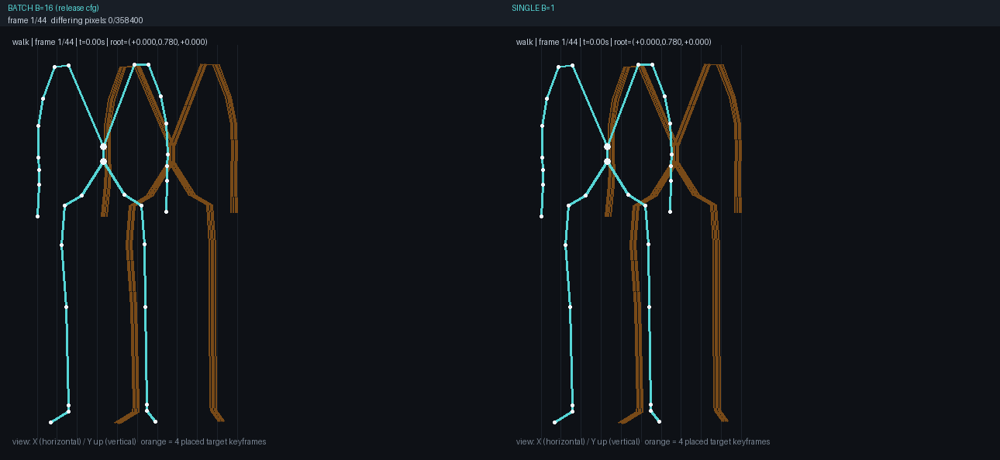
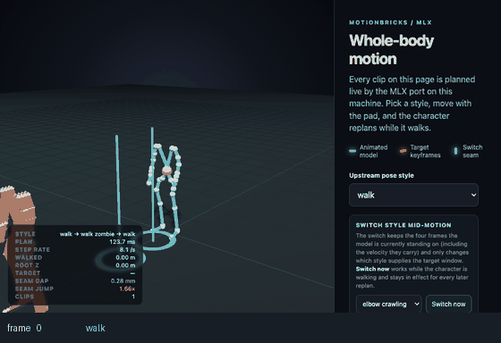
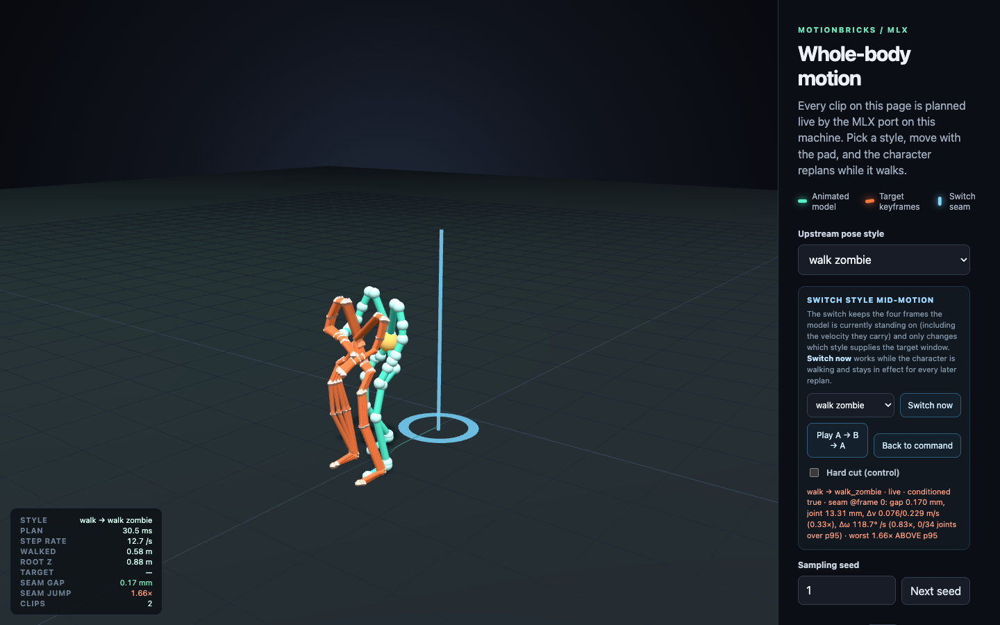
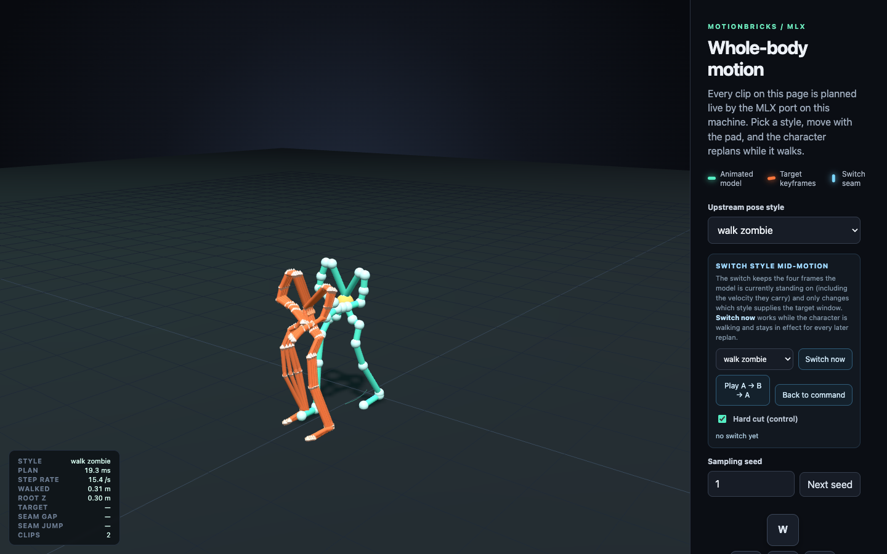
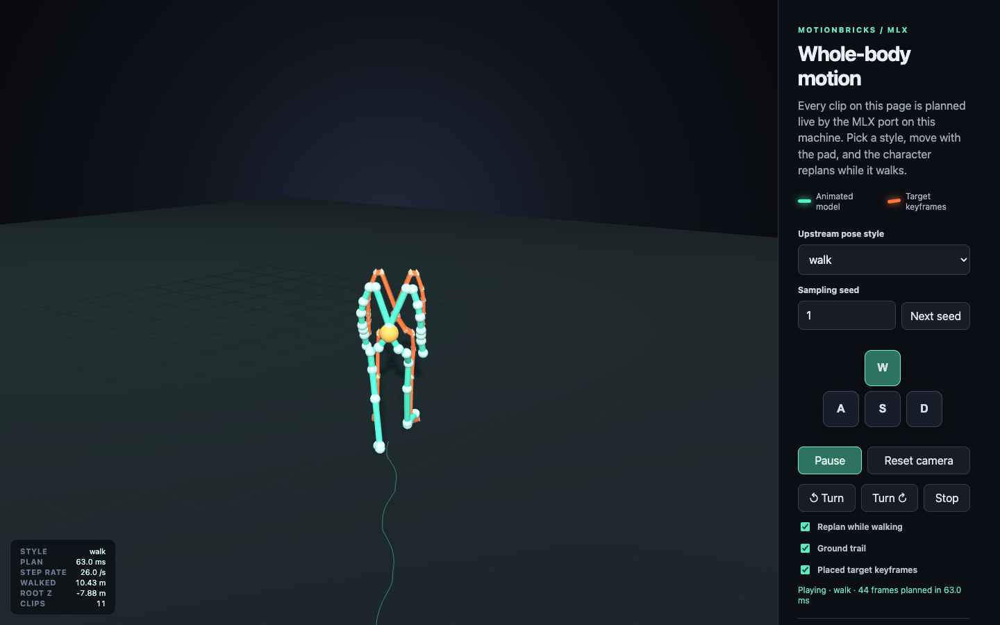

# motionbrick-mlx
中文: [README.zh-CN.md](README.zh-CN.md)

Running MotionBricks inference on Apple Silicon with **MLX**: the default is
**single-scenario planning**
(GPU p50 **26.6 ms**; the GPU and CPU backends produce **byte-identical** plan documents, and
stage-by-stage alignment against the reference runtime is
`TRACE OK` with **zero difference** in discrete tokens), and on this inference path it lands a whole
set of usable artifacts —
**offline batch baking** (bake a library of real motions in one go, export playable plan documents and
animations; end-to-end **4.44×** for a single-style duration-homogeneous library at the release tier),
a **browser viewer** (every motion segment on the page is computed live by MLX on this machine, not
pre-recorded),
**target keyframes** (place 1–4 target frames on the page, with the hit error printed on the HUD)
and **A→B→A motion switching** (conditioning on the current state, with a falsifiable hard-cut control).

**The current delivery stops here.** The training line and "video / third-party motion → clip" are
**out of scope for now**;
for where the B/C lines stand right now, why they are on hold, and where the interface is frozen, see
[§5 "Current scope and what we do not do"](#5-current-scope-and-what-we-do-not-do).

The upstream architecture comes from NVIDIA MotionBricks (`motionbricks/` in
`NVlabs/GR00T-WholeBodyControl`).
This repository takes the **Apache-2.0 source route only**: it does not use, convert, or redistribute
their pretrained weights, see [`NOTICE`](NOTICE).

> **Where the numbers come from**: every number below is tagged with the document and section it comes
> from; the numbers in those documents were all measured **on the tree of their HEAD commit**.
> Load on this machine inflates absolute values by about 10 %, so absolute timings are supporting
> evidence only — the conclusion is the same-process paired ratio (see "Honest boundaries").

---

## 1. Accepted numbers

### 1.1 Default path (single-scenario planning)

The two backends are run **in separate processes**, because running GPU first and CPU second in the
same process would charge the second backend with a higher peak memory
([SUMMARY](docs/SUMMARY.md) §1, [optimization-report](docs/optimization-report.md) §22.2).
Measurement conditions: load average 6.1–7.7, 25 steps, 4 real styles rotated.

| Backend | p50 | p90 | max | Cold start (load + first step) | MLX peak | Process RSS | Determinism |
|---|---|---|---|---|---|---|---|
| GPU (Metal) | **26.6 ms** | 37.2 | 40.4 | 317 ms | 779 MB | 846 MB | True |
| CPU | **173.1 ms** | 198.0 | 213.3 | 497 ms | 748 MB | 856 MB | True |

Source: [SUMMARY](docs/SUMMARY.md) §1. Against the round-1 acceptance baseline of GPU p50 55.5 ms this
is **2.09×**.

### 1.2 Alignment, bit-identity, and the cross-version gate

| Check | Measured | Source |
|---|---|---|
| GPU plan document sha256 | `ccda1952c967c8d7e893a795908f7de278f2acda1ce5ba1e1889692a8904a7c5`, **byte-identical** to `out/plan-mlx-gpu.json` | [SUMMARY](docs/SUMMARY.md) §1 |
| CPU plan document sha256 | `262e77d438daa8a790eccf23f8cfd696bf620a304bb4d42b54e38282e085b64a`, **byte-identical** to `out/plan-mlx.json` | [SUMMARY](docs/SUMMARY.md) §1 |
| `mlx_align.py plan` (against the reference artifacts) | `ALIGNMENT OK`; worst margin **rotation angle 0.26×** of tolerance (roots 6.8e-07 m, rotations 8.7e-06) | [SUMMARY](docs/SUMMARY.md) §1 |
| `mlx_align.py trace` (both backends) | both `TRACE OK`; `pose.tokens` / `pose.sampling_uniforms` / `decoder.quantized` are all `0.000e+00` | [SUMMARY](docs/SUMMARY.md) §1 |
| Cross-version gate: 5 seeds × 6 steps (against `c81d8ee`) | tokens **30/30**, uniforms **30/30**, duration **30/30**, **0/26576** decisions differ, final motion deviation **0.000e+00** | [VIEWER](docs/VIEWER.md) §8 |
| `pytest -q` | **308 passed, 1 skipped** | [VIEWER](docs/VIEWER.md) §8 |

### 1.3 Batch baking (release config `--bake-stages all+decode`)

| Check | Measured | Source |
|---|---|---|
| Homogeneous (duration-homogeneous) B=16 end-to-end speedup | **4.443×** (**153.5 scenarios/s**); another independent run 4.429× (144.5/s) | [SUMMARY](docs/SUMMARY.md) §2 |
| Mixed-grouping B=8 / B=16 single-pass speedup | 1.670× / 2.810× (mixed B=16 is **draft**) | [SUMMARY](docs/SUMMARY.md) §2 |
| round-4 driving arm vs single-pass orchestration arm | **bit-identical** at every B and every grouping (`cross_arm_bitwise.bit_identical=True`) | [SUMMARY](docs/SUMMARY.md) §2 |
| Batch vs per-scenario single runs (a separate process, no bake flags at all) | discrete decisions (tokens/uniforms/duration) **bit-identical across 64/64 scenarios**, **0/4032** token decisions differ | [BATCH-BAKE-RUN](docs/BATCH-BAKE-RUN.md) §3 |
| 12-item manifest | three manifests, five groupings, all **12/12**, `manifest check: PASS` | [BATCH-BAKE-RUN](docs/BATCH-BAKE-RUN.md) §2 |
| Final motion consistency (judged by tolerance, not by bit-identity) | roots ≤ **2.027e-06 m** (2.0e-03× of tolerance), rotations ≤ **2.753e-05** (1.4e-02×); the manifest's `bake_action_bit_identical` is **honestly `false`** | [SUMMARY](docs/SUMMARY.md) §2 |
| C-line quality gate `scripts/eval_gate.py --no-collect` | exit 0, **GATE PASS**: 10 quality groups + 2 cross-impl groups all PASS, 5 negative controls all fire as designed | [BATCH-BAKE-RUN](docs/BATCH-BAKE-RUN.md) §4.1 |
| The rendered side-by-side animations | batch arm and single-scenario arm differ in **0/38,574,400 pixels** (all differences land below the pixel) | [BATCH-BAKE-RUN](docs/BATCH-BAKE-RUN.md) §5.3 |



**What this image proves**: the left (`BATCH B=16 (release cfg)`) and the right (`SINGLE B=1`) are
**two planning runs of the same walk scenario**,
all skeleton pixels come from the reference renderer, and this repository's `tools/side_by_side_gif.py`
only stitches them side by side and counts pixels in passing.
Each frame of the w05 pair writes `differing pixels 0/358400` in its own corner; across the four
scenarios the total is **0/38,574,400 pixels** different
(all differences land below the pixel), while the discrete decisions are **64/64 scenarios, 0/4032
tokens bit-identical** (the two rows in the table above).
**Source**: the round-7 baking campaign; the render and stitching commands are in
[BATCH-BAKE-RUN](docs/BATCH-BAKE-RUN.md) §5.1–§5.3,
and the file trade-offs are in
[`artifacts/bake-2026-10-12/README.md`](artifacts/bake-2026-10-12/README.md).

### 1.4 Switching (conditioned generation for A→B)

The criterion is the task brief verbatim: at the seam `|dq|` ≤ the `p95(|dq|)` within that segment,
`q ∈ {position, velocity, acceleration}`
(48 cells = 8 style pairs × seed 1/7 × seam frames 12/20/28, all measured cell by cell interleaved in the
same process,
[VIEWER](docs/VIEWER.md) §3).

| Quantity | Criterion | **This method (conditioned)** | Hard-cut control (snapped to the seam pose) |
|---|---|---|---|
| root position difference (max over 48 cells) | ≤ one frame's p95 | **1.383 mm** | 116.654 mm |
| worst joint position difference | same as above | **15.352 mm** | 833.761 mm |
| root velocity ratio median / max / cells over criterion | ≤ 1 | **0.302 / 0.472 / 0/48** | 3.084 / 6.455 / 46/48 |
| joint angular velocity ratio median / max / over | ≤ 1 | 1.158 / 2.315 / **32/48 (not met)** | 3.788 / 4.982 / 48/48 |
| joint angular acceleration ratio median / max / over | ≤ 1 | 1.398 / 3.301 / **42/48 (not met)** | 1.969 / 3.777 / 48/48 |

One-line reading: **position and root velocity meet the criterion, and by an order of magnitude**
(position difference 230×, root velocity ratio 10×);
**joint angular velocity is greatly improved (3.3×) but does not meet the criterion**; **joint angular
acceleration is equally bad under both methods**, and that is a mechanism boundary —
the 4 frames of the conditioning window carry only position and a first difference (velocity), with
**no acceleration channel** ([VIEWER](docs/VIEWER.md) §3 end, §10).



**What this image proves**: `walk → walk_zombie → walk` is **one continuous playback on the page**
(the style changes after 20 frames and again after 40 frames),
not two videos stitched together. **How to read it**: the bottom caption strip writes which leg we are
on (`walk` / `walk_zombie`) and the page's frame number;
the two **cyan vertical bars in the picture are the seam markers** (cyan = SWITCH SEAM in the caption),
and the ground trail runs through both seams the whole way
(the GIF's last frame is reached after 82 frames of the page, HUD `WALKED 2.06 m`). **Source**: round 10;
all 42 frames are
one real navigation of `?t=<frame>&paused=1`, and the sha256 of the source PNGs is recorded in
`artifacts/switch-run/gif-digests.txt`
([VIEWER](docs/VIEWER.md) round 10 §6).

| Conditioned switch (this method) | Hard-cut control (the same instant, differing only in `?naive=1`) |
|---|---|
|  |  |

**What these two images prove**: they are a pair **taken at the same instant, with the same camera and
differing only in the single parameter `?naive=1`**. The left one is the conditioned switch,
its HUD gives `SEAM GAP 0.17 mm` / `SEAM JUMP 1.66×` (smaller is better), and the picture has one
**cyan seam bar**;
the right one takes the hard-cut arm (`2:walk_zombie:reset/adv0`: reset to the seam pose, advance
0 frames), its HUD becomes
`SEAM GAP —` / `SEAM JUMP —`, **there is no seam bar on the right**, and at the same instant the
character is only at z = 0.30 m (0.88 m on the left;
the difference recorded in [VIEWER](docs/VIEWER.md) round 10 §6 is 0.57 m).
**Source**: round 10; headless Chrome only navigates and waits, it does not click the UI and does not
synthesize input; the still frame of that seam
(`SEAM GAP 0.28 mm` + two seam bars) is in [`artifacts/switch-shots/seam1-ab-1440x900.png`](artifacts/switch-shots/seam1-ab-1440x900.png),
and the trade-offs are in [`artifacts/switch-shots/README.md`](artifacts/switch-shots/README.md).

### 1.5 Viewer (local browser page)

| Item | Measured | Source |
|---|---|---|
| Cold start (load weights + warm up one plan) | **370.7 ms** (three starts 317.4 / 324.8 / 370.7) | [VIEWER](docs/VIEWER.md) §4 |
| Server-side planning p50 (30 consecutive serial clips) | **28.3 ms → 27.9 clips/s** (of which FK 2.5 ms, HTTP round trip p50 34.8 ms) | [VIEWER](docs/VIEWER.md) §4 |
| Equivalent frame throughput / headroom against 30 fps | **1227 frames/s** / **40.9×** | [VIEWER](docs/VIEWER.md) §4 |
| Seam continuity after a style switch (`advance`) | seam error **≤ 0.55 mm**, world displacement accumulates continuously | [VIEWER](docs/VIEWER.md) §2 |



**What this image proves**: this walk segment on the page is a **real WebGL picture in the browser** —
`PLAN 63.0 ms` and
`STEP RATE 26.0/s` are live numbers the page reports itself, and `CLIPS 11` / `WALKED 10.43 m` show that
it was walked out continuously,
not replaced by a separately written render script. **Source**: round 8; headless Chrome only does
`goto` + `wait_for_timeout`,
with no synthesized input and no clicking the UI (the capture method and per-image sha256 are in
[VIEWER](docs/VIEWER.md) §7; this image is
`f0f706960a1300b6`).

The target-keyframe hit picture (the main image of round 9, `TARGET 0.111 m`; the same image's DOM
attributes
`data-mlx-target-hit=0.111320`, `data-mlx-target-hit-ok=true`, `data-mlx-target-window=40-43`) is also
in the library:
[`artifacts/viewer-targets-shots/final-900-settle.png`](artifacts/viewer-targets-shots/final-900-settle.png)
(source [VIEWER](docs/VIEWER.md) round 9 §5).

Picture evidence is **committed**: `artifacts/viewer-shots/` (1 image), `artifacts/viewer-targets-shots/`
(1 image),
`artifacts/switch-shots/` (4 files, 2.64 MiB). Each directory contains a minimal `README.md` stating
which image is committed and which pictures from the same batch are deliberately left on this machine.

### 1.6 What is explicitly **not achieved**

| Not achieved | Number |
|---|---|
| **The switch's joint angular velocity does not meet the criterion** | 32/48 cells are still above the segment's p95; median 1.158 (control 3.788). Floor control (A→A continued planning within the same style) is itself 1.131–2.174, so this is a mechanism floor, not something the switch introduced ([VIEWER](docs/VIEWER.md) §3, §10) |
| **The switch's joint angular acceleration does not meet the criterion, and both methods are equally bad** | this method 42/48 over the criterion (median 1.398), hard-cut control 48/48 (1.969); `all_seams_within_p95` is `false` in every main configuration. The window of 4 frames has no acceleration channel, **fixing it means changing the model's conditioning channel (training side)** — the training line is on hold by human decision (§5.2), so this residual is **known and not fixed in this round** |
| **After full-stage batching the final motion is not bit-identical** | `bake_action_bit_identical=false`; roots ≤ 2.027e-06 m, rotations ≤ 2.753e-05, judged acceptable by tolerance |
| **The mixed-style homogeneous library tier drops to draft** | `diverse` (8 real styles · homogeneous B=16) ratio **1.2716** (B=8 is 1.4402) → draft; only the single-style homogeneous batch is 0.4089 → release ([BATCH-BAKE-RUN](docs/BATCH-BAKE-RUN.md) §0, §1.4) |
| **Quantization (q8/q4) is not done** | see §5.3 |
| **The viewer has only been validated with a single client, and only the GPU tier has been measured** | `--device cpu` is supported by the protocol but the page has not been measured ([VIEWER](docs/VIEWER.md) §9 item 10) |
| **The target-keyframe hit envelope has boundaries** | about ≤4 m straight ahead, about ≤2–3 m laterally (by style), beyond that `OUT OF TOLERANCE`; the model **neither refuses nor clamps**, it extrapolates to 49 m/s@50 m ([VIEWER](docs/VIEWER.md) round 9 §3) |

---

## 2. How to use

The environment is the **in-repo `.venv`** (Python 3.13.12 + MLX 0.32.3 + NumPy 2.5.4, Metal device),
and the three lines (A/B/C) together with the human use only `./.venv/bin/python`, see
[decision 0001](docs/decisions/0001-python-environment.md).

```sh
cd ~/dev/motionbrick-mlx
./.venv/bin/python scripts/check_env.py          # prints platform/Python/MLX + one matrix smoke test, expect READY
```

**Default single-scenario planning** (`--out` is required, see the §4 hard rules) — run the two backends
in separate processes:

```sh
./.venv/bin/python scripts/mlx_plan.py --device gpu --out /tmp/step-gpu.json
./.venv/bin/python scripts/mlx_plan.py --device cpu --out /tmp/step-cpu.json
diff -q /tmp/step-gpu.json out/plan-mlx-gpu.json     # no output = byte-identical
diff -q /tmp/step-cpu.json out/plan-mlx.json
shasum -a 256 /tmp/step-gpu.json /tmp/step-cpu.json
```

**Timing / cold start / memory / determinism** (again the two backends in separate processes):

```sh
./.venv/bin/python scripts/mlx_bench.py --steps 25 --devices gpu --json /tmp/gpu.json
./.venv/bin/python scripts/mlx_bench.py --steps 25 --devices cpu --json /tmp/cpu.json
```

**Alignment** (against the reference runtime's artifacts, and the stage-by-stage trace):

```sh
./.venv/bin/python scripts/mlx_align.py plan  out/ref/plan-ref.json /tmp/step-gpu.json
./.venv/bin/python scripts/mlx_align.py trace out/ref/trace/transition-0.json --device gpu
./.venv/bin/python scripts/mlx_align.py trace out/ref/trace/transition-0.json --device cpu
```

> The whole `out/` directory is in `.gitignore` and **not committed**: `out/ref/**` (the reference
> runtime's plan and stage-by-stage traces)
> is generated on this machine by [`tools/ref_harness.cpp`](tools/ref_harness.cpp) linking the reference
> checkout's static library,
> and `out/plan-mlx*.json` are the products of the two `mlx_plan.py` commands above. That is to say, the
> `diff`/`align` commands
> need the reference artifacts to be built on this machine first; what is committed in the repository is
> **the sha256 and the alignment conclusions corresponding to those artifacts** (§1.2).

**Baking the release tier** (the homogeneous and mixed groupings; `B=1` is never used, `B>8` must be
duration-homogeneous):

```sh
# mixed (duration-mixed)
./.venv/bin/python scripts/mlx_bench.py --bake-stages all+decode \
    --bake 1,2,4,8 --bake-single-pass --bake-repeats 9 --devices gpu --json /tmp/release-mixed.json
# homogeneous (duration-homogeneous), release tier ceiling B=16
./.venv/bin/python scripts/mlx_bench.py --bake-stages all+decode \
    --bake 1,2,4,8,16 --bake-homogeneous --bake-single-pass --bake-repeats 9 \
    --devices gpu --json /tmp/release-homog.json
```

**Bake a library of real motions and export** (12-item manifest, equivalence comparison, C-line
re-check; the full procedure and artifact list are in
[BATCH-BAKE-RUN](docs/BATCH-BAKE-RUN.md) §5):

```sh
# the batch arm (release config) and the per-scenario single arm (a separate process, no bake flags
# at all), written into the same campaign directory
./.venv/bin/python scripts/mlx_bake_library.py --campaign diverse \
    batch  --batch-size 16 --grouping homogeneous --strict --out artifacts/bake-2026-10-12/diverse
./.venv/bin/python scripts/mlx_bake_library.py --campaign diverse \
    single --batch-size 16 --out artifacts/bake-2026-10-12/diverse
# per-scenario paired comparison (reads the runs-*.json written by the two arms; the artifact
# documents are in their respective plans/)
./.venv/bin/python scripts/mlx_bake_library.py --campaign diverse compare \
    --batch  artifacts/bake-2026-10-12/diverse/runs-batch-B16.json \
    --single artifacts/bake-2026-10-12/diverse/runs-single-B16.json
# verify the written manifest field by field, 12 items
./.venv/bin/python scripts/mlx_bake_library.py --campaign single-style \
    check --manifest artifacts/bake-2026-10-12/single-style/manifest.json
# score this round's artifacts with the C line's same set of thresholds
./.venv/bin/python scripts/mlx_bake_library.py metrics \
    --dir artifacts/bake-2026-10-12/diverse/plans/batch-B16
```

> `*/plans/**` and `runs-*.json` are **deliberately not committed** (byte-reproducible, 128 plan
> documents, 27.7 MiB in total);
> what is committed is `manifest.json`, `compare-B*.json`, `metrics-*.json`, `logs/` and the GIFs, and
> the trade-offs are in
> [`artifacts/bake-2026-10-12/README.md`](artifacts/bake-2026-10-12/README.md).
>
> Rendering to GIF uses `tools/render_motion.py` in the reference checkout (the original file is
> unchanged), and it needs Pillow;
> **this repository's `.venv` has no Pillow**, so that step uses the system Homebrew python, and nothing
> was installed into `.venv`.

**Switching (A→B, and A→B→A)**:

```sh
# splice A->B->A into one segment, write a plan document and print the six ratio lines per seam
./.venv/bin/python scripts/mlx_switch.py --style walk --to walk_zombie --back walk \
    --seed 1 --seam-at 20 --seam-at-back 20 --out /tmp/switch-aba.json
# control matrix + C-line quality gate (the hard-cut control arm is interleaved cell by cell in the
# same process)
./.venv/bin/python scripts/mlx_switch.py --style walk --to walk_zombie --back walk \
    --control --quality --quality-sweep --seeds 1,7 --seam-frames 12,20,28 \
    --out artifacts/switch-run/switch-aba.json --report artifacts/switch-run/report.json
```

**Browser viewer** (single-threaded, binds only `127.0.0.1`; the MLX GPU stream is thread-local, and
multiple threads make a worker abort the process):

```sh
./.venv/bin/python scripts/mlx_viewer.py --port 8848 --device gpu > /tmp/viewer.log 2>&1 &
curl -s http://127.0.0.1:8848/api/health          # device / parameter count / cold start / cumulative counters
curl -s "http://127.0.0.1:8848/api/plan?style=walk&seed=1&move=0,1&facing=0,1&reset=1" > /tmp/plan.json
curl -s http://127.0.0.1:8848/api/stats           # server rolling timings + the last page self-reported cost
kill "$(lsof -nP -iTCP:8848 -sTCP:LISTEN -t)"     # stop
```

(The continuous step-rate probe script `artifacts/viewer-run/probe_viewer.py` is a local artifact and
**not committed**;
usage and output are in [VIEWER](docs/VIEWER.md) §4, §10.)

The page is at `http://127.0.0.1:8848/`: 15 real `.mbstyle`, camera orbit, ground trail,
**YOUR TARGET KEYFRAMES** (click the ground to place 1–4 target frames, the HUD gives the root hit
error),
**SWITCH STYLE MID-MOTION** (switch while walking, the HUD gives `SEAM GAP` and `SEAM JUMP`,
and you can tick `Hard cut (control)` to see the control arm). URL parameters (`?style=`, `?seed=`,
`?move=`, `?targets=`,
`?switch=`, `?t=&paused=1`) are only address-bar presets, not synthesized input.
**The server stops when the session ends**: it has exactly one stateful agent, and with nobody connected
it is just an idle local process.

**Tests**:

```sh
./.venv/bin/python -m pytest -q
```

---

## 3. Directory layout

```
docs/decisions/0001..0010.md   the text of each key ruling (environment, prior art, runtime, bit-identity,
                               backend-conditional, bake-safe tier, tier rules, margin threshold,
                               batch decode, scenario-level safety metric)
docs/SUMMARY.md                the A-side wrap-up baseline: default-path numbers, tiers and rationale, one-command repro, honest boundaries
docs/VIEWER.md                 viewer: URL/start-stop, protocol, interaction, performance, reuse and attribution, boundaries (incl. target frames and switching)
docs/BATCH-BAKE-RUN.md         the first real baking measurement: scenarios, the 12-item manifest, equivalence, quality gate, artifacts
docs/optimization-report.md    the long-form evidence (§1–§49, including rejected items and why)
docs/motion-representation.md  the motion representation contract (data blocks, units, on-disk layout)
docs/status-{deepseek,claude,glm}.md   each line's own status, files in motion, blockers
docs/brief-{claude-training,glm-eval}.md   the work orders for the B / C lines
src/motionbricks_mlx/motion/   representation, retargeting, read/write
src/motionbricks_mlx/models/   the MLX root/pose/decoder and the batch-baking orchestration
src/motionbricks_mlx/data/     dataset loading, agent, context, target frames, switching
src/motionbricks_mlx/export/   plan document / VRMA export
src/motionbricks_mlx/training/ B: training scaffold (VQ-VAE, dataset, checkpoint) — committed, **paused** per §5.2, not connected to real data
src/motionbricks_mlx/eval/     C: motion quality metrics and the regression gate (delivered and in use, §5.2)
scripts/mlx_{plan,bench,align,convert_gguf,plan_targets,switch,viewer,bake_library}.py
viewer/                        the browser page (own HTML/CSS/JS + the reference demo's three.js vendor and skeleton modules)
tools/side_by_side_gif.py      stitching only (all pixels come from the reference renderer)
tests/                         308 passed, 1 skipped
artifacts/bake-2026-10-12/     baking evidence (manifest, comparisons, logs, GIFs; see that directory's README.md for what is committed)
artifacts/viewer-shots/        the viewer main image (1 image)
artifacts/viewer-targets-shots/ the target-keyframe hit main image (1 image)
artifacts/switch-shots/        switching pictures: aba.gif + the live-switch / hardcut-control pair + the seam still
artifacts/switch-run/  artifacts/{bake-2026-10-12,viewer,viewer-targets}-run/
                               local artifacts (report/plan/log/pid/probe/GIF intermediate frames), **not committed** (per-directory trade-offs in each README.md)
datasets/  checkpoints/  out/  local artifacts, not committed (.gitignore)
```

---

## 4. Tiers and hard rules

The criteria are **frozen before any work starts**, and changing one requires a new entry in
`docs/decisions/`:

* **release tier = perturbation / tightest decision margin ≤ 0.70** ([0008](docs/decisions/0008-margin-threshold-and-grouping.md));
  measured against this rule: **mixed grouping release B ≤ 8** (B=8 ratio 0.6695, B=16 is 1.0426 = zero
  margin → draft),
  **duration-homogeneous B ≤ 16** (0.4089–0.5290, [SUMMARY](docs/SUMMARY.md) §2).
  The tier is **data-dependent**: putting 8 real styles into the same homogeneous batch measures a ratio
  of 1.2716 → draft
  (the mechanism is "the numerator comes from `idle`'s large perturbation, the denominator from
  `walk_zombie`'s tight margin"; the largest per-scenario ratio of its own is only 0.142;
  [BATCH-BAKE-RUN](docs/BATCH-BAKE-RUN.md) §1.4).
* **`B = 1` is never used for baking** — it is slower than serial (mixed 0.849–1.008×, homogeneous 0.906×).
* **`B > 8` must be grouped by duration homogeneity**; mixed grouping at B=16 has zero margin.
* **Changing the model / the weights / the instruction distribution → the campaign must be re-run and
  the margins recomputed**, and any B with a ratio > 0.70 is mechanically downgraded.
* **Every `mlx_plan.py` invocation must pass an explicit `--out`** (round 2 once overwrote an accepted
  document).
* An artifact manifest must record the **12 items** required by `0007` item 4; `bake.manifest_fields` is
  generated per B and
  `check` verifies the written file field by field.

---

## 5. Current scope and what we do not do

### 5.1 Current delivery scope (it stops here)

What this repository delivers right now is the complete set of artifacts on this inference path:

| Deliverable | Status | Evidence |
|---|---|---|
| MLX inference, bit-aligned with the reference runtime | **Done** | §1.1, §1.2 |
| Optimization tiering (a mechanical criterion for release / draft) | **Done** | §1.3, §4 |
| release-tier batch baking (`--bake-stages all+decode`) | **Done** | §1.3, §1.6 |
| Browser viewer (single client, GPU tier measured) | **Done** | §1.5 |
| Target keyframes (placed on the page, hit reported by the HUD) | **Done**, the hit envelope has boundaries (§1.6) | §1.5 |
| Motion switching (A→B, A→B→A, conditioned generation) | **Done**: position and root velocity meet the criterion, joint angular velocity/acceleration do **not** (§1.6) | §1.4 |

### 5.2 The training line and "video / third-party motion → clip" are out of scope for now

**The human has decided to put this line on hold**, and the reason is the data source, not the
engineering effort: the motions available in the space are **the batch that ships with Unity plus a few
BONES motions**, and training on them directly would just learn the mechanical feel along with them;
"converting video / third-party motion into clips" is the other half, and where the data would come from
is equally unsolved — **a separate item, not part of this repository's mainline**. Accordingly:

* **The C line (`src/motionbricks_mlx/eval/**`, motion quality evaluation and the regression gate) is
  delivered and in use**: this repository's baking artifacts
  are re-checked with the very same thresholds (§1.3's `GATE PASS`, §1.4's quality gate).
* **The B line (`src/motionbricks_mlx/training/**`, the training scaffold) is committed but paused by
  this decision**: the whole chain runs and
  the tests are green, **but it has only ever been fed synthetic shards and has never been connected to
  real data** — do not read it as "training is done".
* **Both lines are separate efforts that meet through a frozen contract**: the on-disk form is the
  `clip.npz` defined by [`docs/motion-representation.md`](docs/motion-representation.md) (plus the
  constants exported by `motion/representation.py`). If someone takes up training in the future,
  **it does not enter this repository's mainline**; they only produce `clip.npz` per this contract and
  hand it to the inference side.
* This decision **does not revoke any committed number**: the two residual rows in §1.4 / §1.6 that say
  "fixing it means changing the model's conditioning channel (training side)"
  stay known and stay unfixed in this round.

### 5.3 Explicitly not done

| Not done | Why (with evidence) |
|---|---|
| **Quantization (q8 / q4)** | it would change the motion: q4 differs in 27–31 % of tokens, 3/6 steps even change duration, roots reach 30–91× the tolerance; q8 differs in 1.5–3.6 %, roots 2.2–25.6×; `mlx_align plan` FAILs against the reference (q8 4 arrays, q4 9). The ruling is in [0004](docs/decisions/0004-adopt-bit-identical-f32.md), [0005](docs/decisions/0005-backend-conditional-compile.md) and report §6/§9. |
| **Further optimization of the single-scenario real-time path** | host math went from 17.58 → 1.74 ms/step (report §12–13); moving FK/constraints into the MLX graph is a **net loss** at B=1 (1.64 ms vs 0.371 ms on the host, and `cos/sin/arctan2` differ from NumPy by 1–2 ULP); `pred_local_defer` / `decoder_defer` are only 1.0207× / 1.0035× at B=1, below the 1.05× threshold, so they are rejected by the criterion. They **only pay off in batch**. |
| **Anything on the reference runtime side** | the reference checkout `~/dev/motion-bricks-cpp` was read-only the whole time, not one byte changed; GGUF / the engine side is outside this repository's scope. |
| **The training line and "video → clip"** | see §5.2: the B line is paused after committing and is not connected to real data; training and the data source are a separate item, delivered only through the `clip.npz` contract. |

---

## 6. License and attribution

* This repository's code is **Apache-2.0** ([`LICENSE`](LICENSE)).
* **NVIDIA pretrained weights are not used, not converted, and not redistributed**: the upstream source
  is Apache-2.0, the weights are under the NVIDIA Open Model License;
  every checkpoint this repository produces is trained on data we generated ourselves ([`NOTICE`](NOTICE)) —
  **no checkpoint has been published at this
  time**, and the B-line training scaffold has only ever been fed synthetic shards (§5.2).
* Viewer reuse: `viewer/vendor/three.module.min.js`, `three.core.min.js`, `THREE-LICENSE.txt` are
  **byte-for-byte copies**
  (three.js itself is MIT); the four sections of `viewer/rig.js` (skeleton rig / label / line drawing)
  and the first 63 lines of `viewer/style.css`
  are **copied verbatim** from the reference demo (Apache-2.0), and the only mechanical changes and the
  original line numbers are written in the file-header comments;
  `viewer/index.html`, `viewer/app.js`, `scripts/mlx_viewer.py` are newly written in this repository.
  The per-block sha256 and the three-part attribution note are in [VIEWER](docs/VIEWER.md) §5.

---

## 7. Decision and evidence index

| Decision | One line |
|---|---|
| [0001](docs/decisions/0001-python-environment.md) | use the in-repo `.venv` throughout (Homebrew python@3.13; MLX 0.32.3 / NumPy 2.5.4) |
| [0002](docs/decisions/0002-prior-art.md) | check prior art first: a GGML version and a Core ML version exist, and on the MLX side there are only VQ-VAE parts |
| [0003](docs/decisions/0003-downstream-runtime.md) | the downstream runtime is `motion-bricks.cpp` (Apache-2.0 / GGML / GGUF boundary) |
| [0004](docs/decisions/0004-adopt-bit-identical-f32.md) | adopt f32 optimizations that are provably bit-identical; quantization stays off |
| [0005](docs/decisions/0005-backend-conditional-compile.md) | the three `*_compile` switches default per backend (off by default away from Metal, avoiding 2× peak memory) |
| [0006](docs/decisions/0006-batch-bake-safe-b.md) | the "safe B" rule for batch baking |
| [0007](docs/decisions/0007-bake-full-stage-tier.md) | the tier rules for full-stage batch baking and the 12 items that a manifest must record |
| [0008](docs/decisions/0008-margin-threshold-and-grouping.md) | make the margin threshold mechanically decidable (≤0.70), `B>8` must be duration-homogeneous, mechanical downgrade |
| [0009](docs/decisions/0009-batch-the-motion-decode.md) | batch the motion decode, and list it as part of the release baking config |
| [0010](docs/decisions/0010-scenario-level-safety-metric.md) | use a scenario-level safety metric to compare perturbation against "the margin of the same decision" |

Evidence documents: [SUMMARY](docs/SUMMARY.md) (the wrap-up baseline), [optimization-report](docs/optimization-report.md) (§1–§49, including rejected items),
[VIEWER](docs/VIEWER.md) (viewer / target frames / switching), [BATCH-BAKE-RUN](docs/BATCH-BAKE-RUN.md) (the first real baking measurement),
[motion-representation](docs/motion-representation.md) (the data contract),
[status-deepseek](docs/status-deepseek.md) / [status-claude](docs/status-claude.md) / [status-glm](docs/status-glm.md).

---

## 8. Honest boundaries

1. **The machine is not idle.** During measurement the 1-minute load average was often 5.6–19.6
   (desktop processes mihomo, WindowServer,
   Chrome, DSH renderer, Lark; no training/eval process), and absolute values are inflated by about
   **10 %**.
   So before/after comparisons always use **same-process interleaved pairing** ratios; cross-B pairing
   uses one process per B (a long-lived process accumulates state across B
   and once measured B=8 as 0.936× instead of 1.1726×).
2. **The rotation-angle column of `mlx_align` has a floor.** In the `plan` comparison the rotation angle
   column reads 4.3e-02–5.1e-02 degrees
   (tolerance 2.0e-01 degrees, i.e. **0.26×**), which is that column's floating-point quantization
   floor, **not a regression**; the remaining columns are on the 1e-07–1e-05 scale.
3. **The four-frame conditioning window has no acceleration channel.** What the window carries is
   position and a first difference; so "position + velocity" can close,
   **acceleration cannot** — the two residual rows for joint angular velocity/acceleration are
   mechanistic, and fixing them means changing the model's conditioning channel (training side).
4. **Motion consistency is judged by tolerance, not by bit-identity.** After full-stage batching the
   final motion has roots ≤ 2.027e-06 m, rotations ≤ 2.753e-05,
   and the manifest's `bake_action_bit_identical=false` records exactly that.
5. **One viewer process = one agent.** Multiple clients would scramble each other's context; every
   measurement in this round was single-client and serial.
   To support several people the agent needs a session key. `--device cpu` is supported by the protocol
   but the page has not been measured.
6. **The server stops when the session ends**, it does no authentication and does not bind a remote
   address (`--host` only accepts `127.0.0.1`).
7. **Only the pictures cited in the body are committed.** `artifacts/viewer-shots/` (1 image),
   `artifacts/viewer-targets-shots/` (1 image), `artifacts/switch-shots/` (4 files, 2.64 MiB) are
   **committed**;
   the remaining frames from the same sessions, `artifacts/{switch,viewer,viewer-targets}-run/**` and
   `artifacts/bake-2026-10-12/*/plans/**`, `runs-*.json`, `render-*.json`, `server.log`, `*.pid`,
   the probe scripts and the GIF intermediate frames are **deliberately not committed** (they are
   reproducible), and the per-directory trade-offs are written in each directory's `README.md`.
8. **The reference GGML's 380 ms is a quoted value**, it was not re-measured or sourced in the
   read-only checkout; the truly comparable figure is this repository's own
   GPU single-scenario p50 26.6 ms ([VIEWER](docs/VIEWER.md) §4).
9. **`/api/client-metrics` keeps only the last page self-report**, it does not aggregate history; the
   HUD's step rate is the sliding median of the last 8 plans.

---

## 9. Division of labor (this repository is advanced by three agents and one human)

**There is only one core rule: one file has exactly one writer at a time.** Cross a boundary only after
coordinating first.

| Owner | Who | File scope | Status |
|---|---|---|---|
| **A. Inference port / optimization / baking / viewer / switching** | **DeepSeek** | `src/motionbricks_mlx/{models,data,export,motion}/**`, `scripts/mlx_*.py`, `tests/test_mlx_*.py`, `tests/test_viewer_*.py`, `viewer/**`, `docs/status-deepseek.md`, `docs/SUMMARY.md`, `docs/VIEWER.md`, `docs/BATCH-BAKE-RUN.md`, `docs/optimization-report.md`, proposals under `docs/decisions/**` | **Done** (rounds 1–10): MLX inference and bit-alignment, optimization tiering, release-tier batch baking, browser viewer, target keyframes, motion switching |
| **B. Model and training** | **Claude Code** | `src/motionbricks_mlx/training/**`, `scripts/train_vqvae.py`, `tests/test_training_*.py`, `docs/status-claude.md` | the training scaffold is **committed** (`bc78bd8`) and the whole chain runs with green tests; but **it has only ever been fed synthetic shards and has never been connected to real data**, and it is **paused** by human decision (§5.2): a future owner delivers only through the `clip.npz` contract and does not enter this repository's mainline |
| **C. Motion quality evaluation and regression gate** | **GLM** | `src/motionbricks_mlx/eval/**`, `scripts/eval_{collect,gate}.py`, `tests/test_eval_*.py`, `docs/status-glm.md` | **delivered and in use** (`306a684`): 6 families of metrics, a threshold table with sources, 5 negative controls, `eval_gate.py` GATE PASS; the A side uses it to re-check baking artifacts (§1.3, §1.4) |
| **D. Frozen zone** | **Human** | `LICENSE`, `NOTICE`, `pyproject.toml`, `.gitignore`, `README.md`, `docs/motion-representation.md` | `LICENSE` / `NOTICE` / `pyproject.toml` / `.gitignore` / `docs/motion-representation.md` are **untouched**; `README.md` has been explicitly authorized by the human to be rewritten (the previous round wrote the front page, this round adds picture evidence and narrows the scope into §5) |

* **Interface first**: A and B/C depend on each other only through `docs/motion-representation.md` (the
  data contract) and
  the constants exported by `motion/representation.py` (`FRAME_DIM`, `OFFSETS`, `CLIP_META_KEYS`).
  A changing these equals a contract change and must come with a schema version and migration notes;
  B/C must not change the contract themselves.
  This contract is also **the only hand-off surface for a future training owner** (the B line is paused
  per §5.2).
* **Status files are not shared**: each writes only their own `docs/status-*.md`, to avoid overwriting
  each other (we learned that lesson once).
* **Commit discipline**: commit only the files under your own name; `datasets/`, `checkpoints/` and
  `out/` are not committed,
  and datasets and checkpoints are reproduced from a **manifest** (`git sha + random seed + hyperparameters + data source id`);
  every commit states clearly "what verification was actually run this round", **never write "the whole
  suite was verified"**; only one person may run long training at a time.
* **What the human decides**: scope and priorities, the trade-offs in the motion representation,
  aesthetics, everything license-related, the rulings in `docs/decisions/**`
  (agents only write proposals), and pushing to `main`. **"The training line and video → clip are on
  hold for now" is exactly one such scope decision**
  (§5.2); it puts work on hold, not committed conclusions.
* **Every conclusion carries evidence**: a threshold must be able to fail ("break it and it goes red"),
  numbers must come from real runs, and anything unclear is written down as "unverified".
